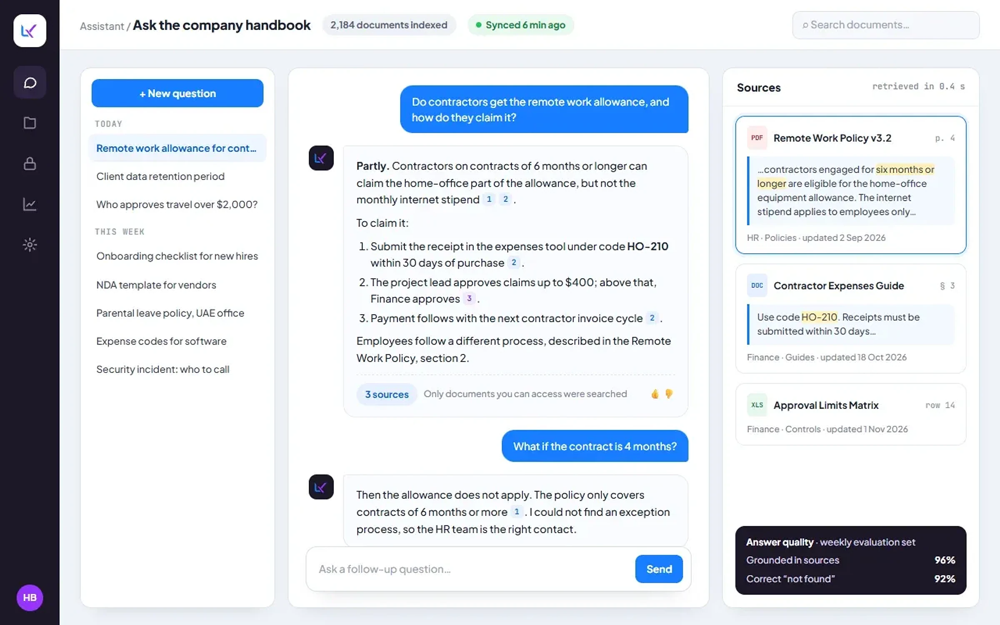

<!-- styled:v2 -->

**> **Solution blueprint.** A reference architecture Lexvaxa designed for this problem, not a delivered client project.**

  <a href="#overview">Overview</a> ·
  <a href="#key-features">Key features</a> ·
  <a href="#tech-stack">Tech stack</a>

---

**A private assistant that answers staff questions from the company’s own documents, with the source shown for every answer.**

      

## Overview

A solution blueprint for teams whose answers are buried in policies, contracts, wikis and shared drives. Documents are indexed with access rights kept, and the assistant answers in plain language, quotes the passages it used and says when it does not know.

## The challenge

Staff spend hours searching folders or asking colleagues, and generic chatbots invent answers.

## The solution

Retrieval-augmented generation over the company’s own documents, with permissions respected, citations on every answer and an evaluation set to keep quality measurable.

## Key features

- Answers with cited sources
- Document access rights respected
- Says “not found” instead of guessing

## Tech stack

    

## Privacy

This blueprint uses illustrative data only.

## Links

- Case study on Lexvaxa: https://lexvaxa.com/work/company-knowledge-assistant

---

**Built by [Ch Muhammad Samiullah](https://github.com/samiullah156-creator)** · AI Automation Engineer and Full-Stack Developer at [Lexvaxa](https://lexvaxa.com)

⭐ Star this repo if you found it useful

